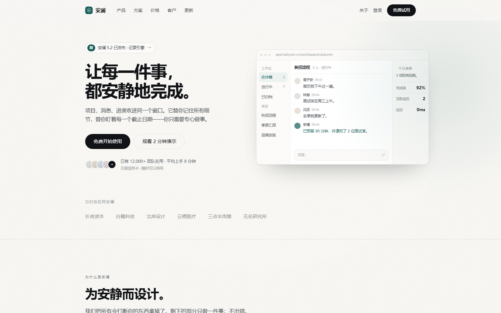
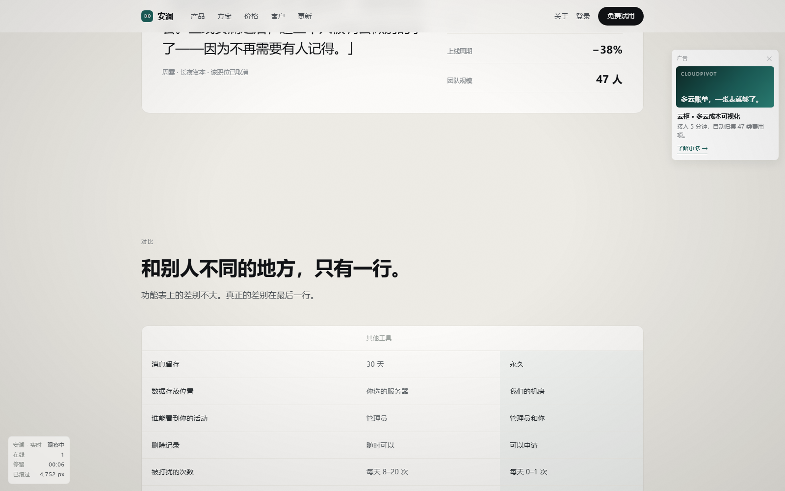
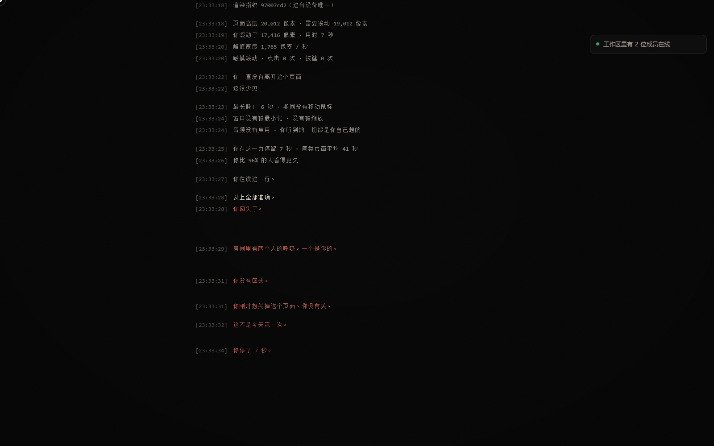
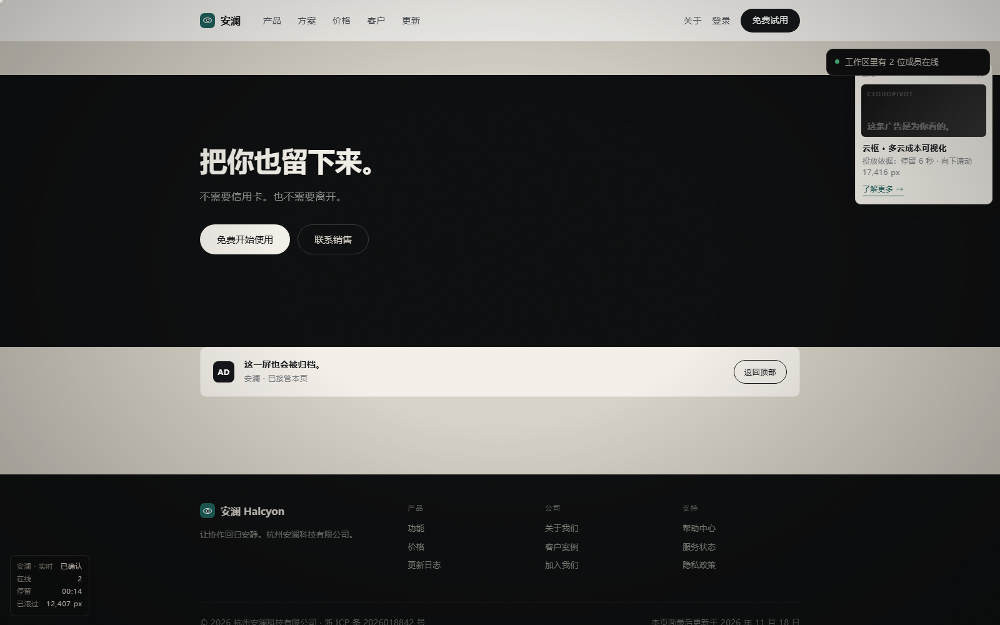

<p align="center">
  
</p>

<h1 align="center">安澜 Halcyon</h1>

<p align="center">一个越往下滚越不对的产品官网。<br>单文件、零依赖、无外部资源。</p>

<p align="center">
  <a href="https://halcyon.gongfpp.icu">独立站</a> ·
  <a href="https://game.gongfpp.icu/halcyon/">游戏匣入口</a> ·
  <a href="#它到底怎么变的">实现说明</a> ·
  <a href="#先说清楚">它在采集什么</a>
</p>

---

## 这是什么

打开时它是一个挑不出毛病的企业协作 SaaS 落地页：淡米色背景、克制的字距、三栏价格表、客户证言、媒体引用、更新日志、招聘信息。

然后页面开始不对。字距一点点变宽，留白一点点变大，纸色一点点变暖，文案在被逐个字改写。滚到后半段，它会开始记录你——**滚动像素、停留时长、切没切标签页、屏幕分辨率、设备型号、渲染指纹**，全部真实。最后几行会出现一些它不可能知道的事。

两个入口，同一份内容：

- 独立站 <https://halcyon.gongfpp.icu>
- 游戏匣 <https://game.gongfpp.icu/halcyon/>

## 截图

首屏——刻意做得毫无破绽，第一眼就是个正经官网：



中段——对比表最后一行开始说实话，左侧状态面板出现，右侧挂着一条正常得不能再正常的广告：



结尾——终端风格的会话记录，前面几十行全都是真的：



结尾 CTA：



## 先说清楚

**页面不联网。** 没有 `fetch`、没有 `XMLHttpRequest`、没有第三方统计、没有外链字体。所有"采集"到的信息只停留在当前页面的内存里，渲染成文字，关掉就没了。你可以断网打开，效果完全一样。

它确实会读到这些浏览器公开信息：

- `screen.width / height`、`devicePixelRatio`、`innerWidth / innerHeight`
- `navigator.userAgent`（从中解析设备型号与浏览器版本）、`language`、`hardwareConcurrency`、`deviceMemory`、`connection.effectiveType`、`maxTouchPoints`
- `Intl.DateTimeFormat().resolvedOptions().timeZone`
- `history.length`（本标签页的浏览历史条数）
- 用 Canvas 画一小段文字再取像素算出的哈希——这是常见的**设备指纹**手法，同一台设备每次都一样
- 你的滚动距离、鼠标累计移动、点击次数、按键次数、切标签页时长、最长静止时间

这些信息任何网页都能拿到。这个页面的坏心思在于，它把它们**一句一句写给你看**，然后紧接着写一句它不可能知道的。

## 它到底怎么变的

整个退化由三个进度量驱动：

| 变量 | 含义 |
|---|---|
| `p` | 全页滚动进度 |
| `pc` | 内容进度，`y / 结尾CTA的位置`，驱动连续退化 |
| `pd` | 会话日志段内部的进度 |

连续退化是一个插值系数 `k = pow(clamp((pc-0.05)/0.92,0,1),1.25)`，它同时插值：字距 `0 → 0.048em`、段间距 `112 → 158px`、容器宽 `1120 → 1024px`、纸色、暗角强度。

文字改写不是 CSS 动画，是 JS 直接改 `textContent`：先把原句从尾部逐字吃掉，再逐字写上新句——两个阶段的中间态都是合法前缀，所以看起来像「字被抹掉又重新写上去」，而不是打错字。

前两屏（`y < 2×视口高`）强制保持干净：logo 不会变成眼睛，不会有浮动面板，不会有广告弹出来。所有异常都排在你离开首屏之后。

## 性能上踩过的坑

页面滚动时要连续改字距和留白。第一版直接每帧写 CSS 变量，而 `letter-spacing` 挂在 `body` 上——等于**每一帧触发一次全页重排**，滚动肉眼可见地卡。

现在的做法：

1. 布局型变量（字距 / 间距 / 宽度）**量化到档位**并限频到约 9fps，视觉上看不出阶梯；
2. 文本改写降到 22fps，动画期间锁 `min-height`，避免行数变化把下面内容顶来顶去；
3. 无头 Edge + CDP 实测连续滚动 60 步，`longtask` 0 条。

## 跑起来

```bash
# 直接打开
start index.html          # Windows
open index.html           # macOS
```

没有构建步骤，没有依赖，`index.html` 自己就是全部。

## 部署

`index.html` 有**两个线上入口**，同一份内容：

| 入口 | 托管 | 发布方式 |
|---|---|---|
| `halcyon.gongfpp.icu` | 腾讯云 EdgeOne Pages（免费证书，90 天自动续期） | `edgeone makers deploy . -n halcyon` |
| `game.gongfpp.icu/halcyon/` | 自建服务器 Caddy，作为游戏匣里的一个条目 | 由游戏匣仓库 `npm run deploy` 发布 |

因为它们各存一份副本，**只改一边就会分叉**。所以别单独发布，跑这个：

```bash
./deploy.sh           # 同步副本 → 发布游戏匣 → 发布 EdgeOne → 校验两边 md5 一致
./deploy.sh --check   # 只校验两边是否一致，不发布
```

脚本最后会打两个入口的 md5，不一致就退出码 1。

## 许可

代码拿去做别的用途随意。品牌名、文案、客户证言、媒体报道均为虚构，与现实中的任何公司、产品、个人无关。
